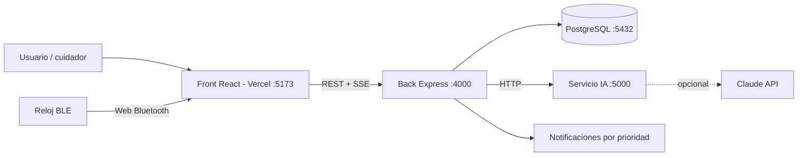
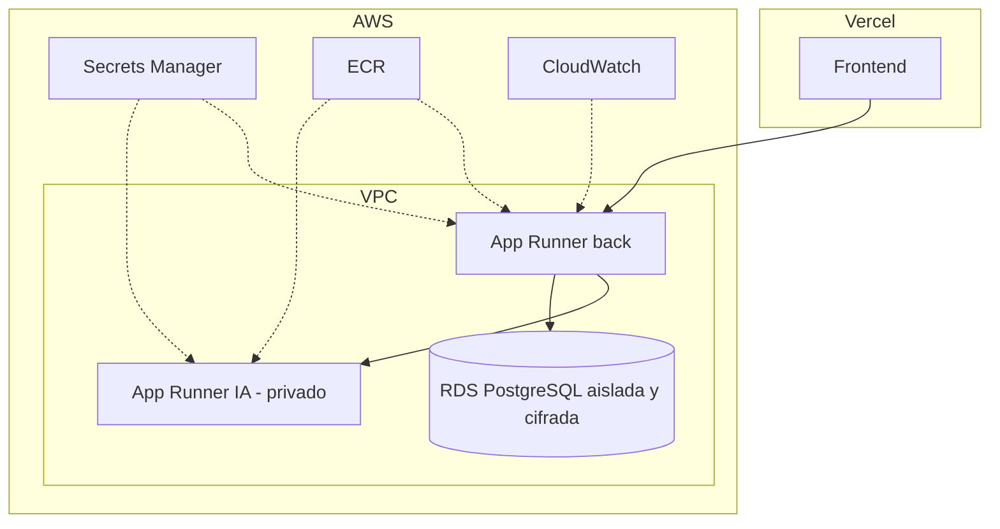

# EpiSafe IA

Sistema inteligente de prevencion y asistencia para personas con epilepsia: registra crisis, medicacion y habitos, estima el riesgo diario con IA, vigila el pulso desde un reloj inteligente y avisa a los contactos de emergencia por orden de prioridad.

Proyecto final de estructuras de datos, **100% TypeScript**. Este repositorio (`episafeIA`) contiene la documentacion, la infraestructura como codigo (AWS CDK), el `docker-compose` que levanta todo el sistema y la CI.

## El problema real

La epilepsia afecta a unos 50 millones de personas en el mundo (OMS). Su dificultad central es la **impredecibilidad**: una crisis puede ocurrir en cualquier momento, y quien la sufre muchas veces esta solo, sin poder pedir ayuda. A eso se suman:

- **Olvidos de medicacion**, una de las causas mas comunes de crisis evitables.
- **Desencadenantes poco visibles** (falta de sueno, estres, cafeina, alcohol) que la persona y su neurologo rara vez pueden cruzar a mano.
- **Consultas medicas con memoria incompleta**: "cuantas crisis tuvo este mes?" se responde de memoria.
- **Cuidadores ansiosos** sin forma de saber si la persona esta bien.

## Que hace EpiSafe IA

| Funcion | Descripcion |
|---|---|
| Registro | Crisis (fecha, duracion, severidad, tipo), registro diario (sueno, estres, cafeina, ejercicio, animo) |
| Medicacion | Horarios, recordatorios, adherencia, autocompletado de medicamentos |
| Emergencia | Un boton registra fecha, hora y ubicacion y notifica a los contactos por prioridad |
| IA | Patrones personales ("80% de tus crisis ocurrieron tras dormir menos de 5 h"), puntaje de riesgo diario explicable, explicaciones en espanol |
| Reloj inteligente | Pulso y movimiento en vivo por Web Bluetooth; alertas de taquicardia, movimiento convulsivo o caida |
| Informe medico | Resumen para el neurologo en JSON o HTML |

> EpiSafe IA no diagnostica, no prescribe y no reemplaza la atencion medica. Ver [limites eticos](docs/modelo-ia-y-etica.md).

## Mapa de repositorios

| Repo | Rol | Puerto local |
|---|---|---|
| [episafeIA](https://github.com/gabmn0704/episafeIA) | Documentacion, infraestructura (CDK), docker-compose, CI | - |
| [EpisafeIa_back](https://github.com/gabmn0704/EpisafeIa_back) | API REST (Express + TS), estructuras de datos, patrones de diseno | 4000 |
| [episafeIA_IA](https://github.com/gabmn0704/episafeIA_IA) | Servicio de IA (patrones, riesgo, anomalias, explicaciones) | 5000 |
| [EpisafeIA_front](https://github.com/gabmn0704/EpisafeIA_front) | Aplicacion web (React + TS), desplegada en Vercel | 5173 |
| [EpisafeIa_BD](https://github.com/gabmn0704/EpisafeIa_BD) | Esquema PostgreSQL, migraciones y seed | 5432 |

## Arquitectura





Detalle y mas diagramas (secuencias de emergencia y reloj, ER) en [docs/arquitectura.md](docs/arquitectura.md).

## Como correr todo en local

Requisitos: Docker con Compose v2. Los cinco repos deben ser **carpetas hermanas**:

```bash
mkdir episafe && cd episafe
for r in episafeIA EpisafeIa_BD EpisafeIa_back episafeIA_IA EpisafeIA_front; do
  git clone https://github.com/gabmn0704/$r.git
done

cd episafeIA
cp .env.example .env          # opcional: agrega ANTHROPIC_API_KEY
docker compose up --build
```

`docker compose` levanta, en orden: PostgreSQL, migraciones + seed, servicio IA, back y front.

| Servicio | URL |
|---|---|
| Web | http://localhost:5173 |
| API | http://localhost:4000/api/v1 |
| IA | http://localhost:5000 |
| PostgreSQL | localhost:5432 (db `episafe`, usuario `episafe`, clave de desarrollo `episafe_dev`) |

Usuario demo: `demo@episafe.app` / `Demo1234!` con 90 dias de datos sinteticos. Mas detalles y solucion de problemas en [docs/desarrollo-local.md](docs/desarrollo-local.md).

## Despliegue

- **Frontend:** Vercel. Variable `VITE_API_URL`; `vercel.json` de referencia en [docs/reference/vercel.json](docs/reference/vercel.json). Guia: [docs/despliegue-vercel.md](docs/despliegue-vercel.md).
- **Back, IA y base de datos:** AWS con CDK en [infra/](infra/README.md) (VPC, RDS privado y cifrado, ECR, App Runner, Secrets Manager, CloudWatch; parametros `dev` y `prod`).

```bash
cd infra && npm ci && npm test && npx cdk synth -c stage=dev
```

Estado: `cdk synth` y las pruebas de infraestructura pasan; `cdk deploy` aun no se ha ejecutado (sin cuenta AWS).

## Documentacion

| Documento | Contenido |
|---|---|
| [arquitectura.md](docs/arquitectura.md) | Componentes, flujos, modelo de datos |
| [decisiones-tecnicas.md](docs/decisiones-tecnicas.md) | Por que cada eleccion |
| [estructuras-de-datos.md](docs/estructuras-de-datos.md) | Catalogo con Big-O y justificacion |
| [patrones-de-diseno.md](docs/patrones-de-diseno.md) | Singleton, Factory, Builder, Prototype, Proxy y mas |
| [reloj-inteligente.md](docs/reloj-inteligente.md) | Estado, limites y alternativas cloud |
| [modelo-ia-y-etica.md](docs/modelo-ia-y-etica.md) | Modelo, evaluacion y limites eticos |
| [privacidad-y-seguridad.md](docs/privacidad-y-seguridad.md) | Plan para datos de salud |
| [despliegue-vercel.md](docs/despliegue-vercel.md) | Frontend en Vercel |
| [desarrollo-local.md](docs/desarrollo-local.md) | Entorno local y problemas comunes |
| [presentacion-final.md](docs/presentacion-final.md) | Diapositivas y guion de la demo |
| [rubrica-checklist.md](docs/rubrica-checklist.md) | Requisitos de la entrega |

## Estado y pendientes

- Reloj inteligente: implementado (Web Bluetooth en el front, ingesta y reglas en el back); **pendiente de prueba con un dispositivo real**.
- Despliegue en AWS: infraestructura lista y validada con `synth`; pendiente de cuenta y primer deploy.
- Presentacion final: guia lista; faltan las diapositivas.

## Licencia

Proyecto academico. Todos los datos de ejemplo son sinteticos.
