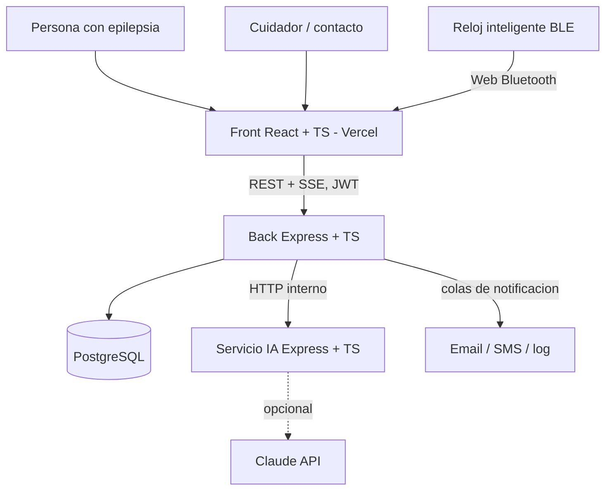
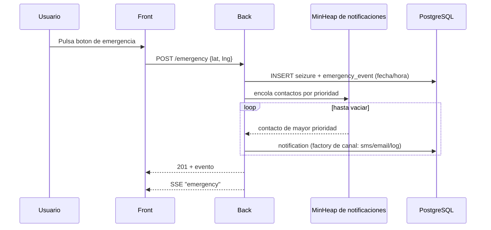
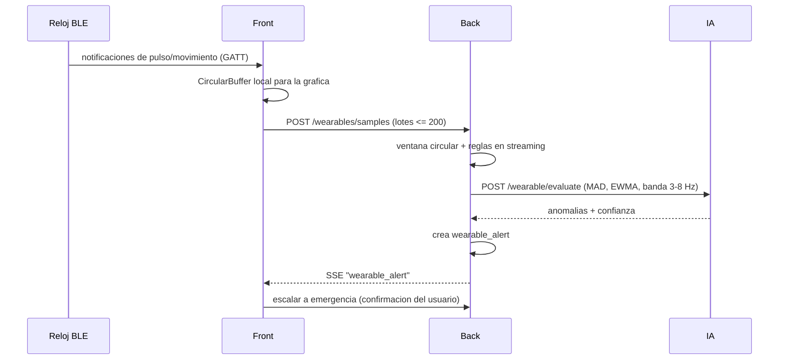
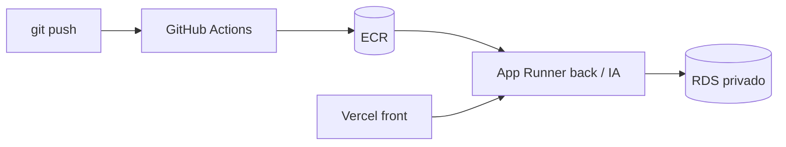
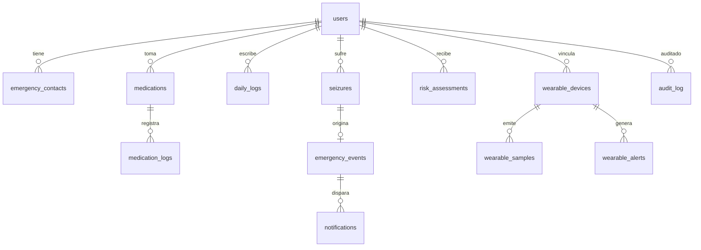

# Arquitectura

## Vista de contexto

## Componentes y responsabilidades

| Repo | Responsabilidad | Puerto local |
|---|---|---|
| `EpisafeIA_front` | UI en espanol, estructuras locales (Stack undo, Queue toasts, Trie, CircularBuffer de pulso), Web Bluetooth | 5173 |
| `EpisafeIa_back` | Auth JWT, CRUD, emergencia, informes, ingesta de wearables, orquestacion hacia IA, SSE | 4000 |
| `episafeIA_IA` | Patrones, riesgo logistico, deteccion de anomalias del reloj, explicaciones | 5000 |
| `EpisafeIa_BD` | Esquema, migraciones TypeScript (`schema_migrations`), seed de 90 dias | 5432 |
| `episafeIA` | Documentacion, IaC (CDK), docker-compose, CI | - |

## Flujo de emergencia

## Flujo del reloj inteligente

## Flujo de riesgo diario

El back reune el registro del dia (sueno, estres, cafeina, ejercicio, dosis omitidas) y pide a `POST /risk/score` un puntaje 0-100 con factores explicables. Si el servicio IA no responde, el back calcula un puntaje local simple y marca `degraded: true`, para que la UI avise que es una estimacion reducida.

## Despliegue

Detalle en [infra/README.md](../infra/README.md) y [despliegue-vercel.md](despliegue-vercel.md).

## Modelo de datos (resumen)

Fuente de verdad del esquema: repo `EpisafeIa_BD`.
