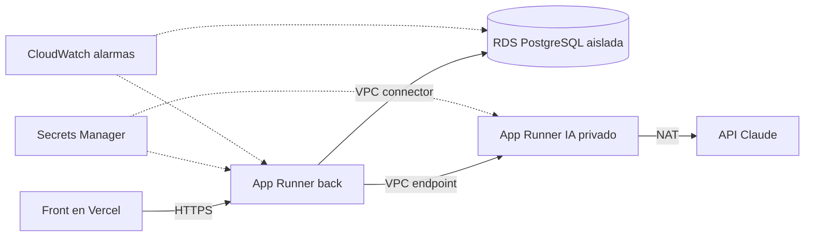

# Infraestructura AWS (CDK, TypeScript)

Define toda la nube de EpiSafe IA como codigo. **No se despliega desde CI ni desde este repo sin credenciales propias**: la validacion automatica solo hace `cdk synth`.

## Stacks

| Stack | Contenido |
|---|---|
| `episafe-<stage>-network` | VPC (subredes publica / privada con NAT / aislada), flow logs de rechazos, security groups (RDS solo acepta 5432 desde la capa de app) |
| `episafe-<stage>-secrets` | Secrets Manager: `jwt-secret` (generado) y `anthropic-api-key` (se carga a mano) |
| `episafe-<stage>-database` | RDS PostgreSQL 16 en subred aislada, cifrado KMS con rotacion, backups, SSL forzado, logs a CloudWatch, secreto `db` y `database-url` |
| `episafe-<stage>-registry` | ECR `back` e `ia` con escaneo al subir y limpieza de imagenes viejas |
| `episafe-<stage>-services` | App Runner: **back** (publico) e **IA** (privado, solo accesible desde la VPC por VPC Ingress Connection), VPC connector, autoscaling |
| `episafe-<stage>-observability` | Topic SNS, alarmas (RDS CPU/espacio/conexiones, 5xx y latencia p95) y dashboard |



## Parametros por stage (`lib/config.ts`)

| | dev | prod |
|---|---|---|
| NAT gateways | 1 | 2 |
| RDS | t4g.micro, Single-AZ, 3 dias de backup | t4g.small, **Multi-AZ**, 14 dias, proteccion contra borrado, snapshot al destruir |
| App Runner | 0.25 vCPU / 0.5 GB, 1-2 instancias | 0.5 vCPU / 1 GB, 2-6 instancias |
| Retencion de logs | 14 dias | 90 dias |
| ECR tags | mutables | inmutables |

Cambia el stage con `-c stage=dev|prod`. La cuenta y la region salen de `CDK_DEFAULT_ACCOUNT` / `CDK_DEFAULT_REGION` (por defecto `us-east-1`); el repo no contiene IDs de cuenta.

## Validar sin credenciales

```bash
cd infra
npm ci
npm run build        # tsc --noEmit
npm test             # assertions sobre las plantillas
npm run synth:dev    # cdk synth
npm run synth:prod
```

## Despliegue manual (cuando haya cuenta AWS)

Orden obligatorio: App Runner no arranca sin una imagen en ECR.

```bash
export AWS_PROFILE=<tu-perfil>
npx cdk bootstrap -c stage=dev
# 1) base: red, secretos, base de datos y registros
npx cdk deploy episafe-dev-network episafe-dev-secrets episafe-dev-database episafe-dev-registry -c stage=dev
# 2) construir y subir imagenes (desde los repos back e IA)
aws ecr get-login-password | docker login --username AWS --password-stdin <ECR_URI>
docker build -t <ECR_URI>/episafe-dev/back:v1 ../../EpisafeIa_back && docker push <ECR_URI>/episafe-dev/back:v1
docker build -t <ECR_URI>/episafe-dev/ia:v1   ../../episafeIA_IA   && docker push <ECR_URI>/episafe-dev/ia:v1
# 3) cargar la API key de Claude (opcional)
aws secretsmanager put-secret-value --secret-id episafe/dev/anthropic-api-key --secret-string "<key>"
# 4) servicios y observabilidad
npx cdk deploy episafe-dev-services episafe-dev-observability -c stage=dev -c imageTag=v1
```

Migraciones: ejecutalas una vez desde un entorno con acceso a la VPC (p. ej. un bastion temporal por SSM o un CodeBuild en la VPC) con `DATABASE_URL` leido de `episafe/dev/database-url`. RDS no es accesible desde internet por diseno.

## Alternativa: ECS Fargate

App Runner es la opcion elegida por simplicidad y costo en un proyecto academico. Si se necesita mas control (sidecars, colas, tareas programadas), el mismo VPC, RDS y secretos sirven para ECS Fargate + ALB sin tocar la capa de datos.

## Pendientes conocidos

- La retencion de los log groups que App Runner crea automaticamente (`/aws/apprunner/...`) se fija manualmente tras el primer deploy.
- `cdk deploy` no ha sido ejecutado (sin credenciales); solo `synth` y tests estan verificados.
- Dominio propio y WAF delante del back quedan como mejora.
